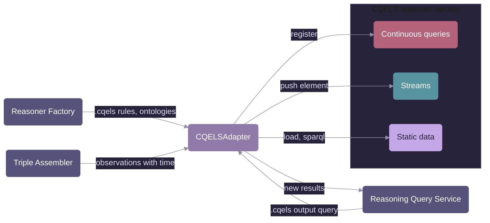

# CQELSAdapter

## Overview

`CQELSAdapter` is responsible for communicating with the CQELS reasoner service using RESTful APIs. It registers continuous queries in CQELS-QL, pushes the observations as stream elements, and returns the new results of each query. Static data (ontologies, SHACL shapes) is loaded into the datastore and can be queried with [SPARQL](https://www.w3.org/TR/sparql11-query/).

> [!NOTE]
> When the `CQELSAdapter` initializes, it creates a datastore in the CQELS service if it does not exist.



## Features

- **Data Store Management**:
  - Initialize and ensure the existence of the datastore.
  - Load static RDF data (Turtle) and query it with SPARQL.

- **Continuous Queries**:
  - `.cqels` files listed under `rules` in the model configuration are registered as continuous queries at start-up, before the first observation.
  - The adapter keeps the id of each query and the streams named after `FROM STREAM`.

- **Observations**:
  - Each set of observations from the Triple Assembler is pushed as one stream element to every stream of the registered queries.
  - The observation time is the event time of the element, so windows follow the time of the observation, not the time of arrival.

- **Results**:
  - A `.cqels` file in the `queries.output` folder returns the results of the registered query with the same text, as SPARQL JSON.
  - Each call returns the rows that came in since the previous call.

## Interface Mapping

| Method               | HTTP target                                   | Notes                                                   |
| -------------------- | --------------------------------------------- | ------------------------------------------------------- |
| `loadData()`         | POST `/content`                               | Static data                                             |
| `loadRules()`        | POST `/queries`                               | CQELS-QL only (`.cqels`); other rule types are rejected |
| `loadObservations()` | POST `/streams/{stream}?eventTime=<ISO-8601>` | One element per stream                                  |
| `queryData()`        | GET `/queries/{id}/results`                   | CQELS-QL: results since the last call                   |
| `queryData()`        | POST `/sparql`                                | SPARQL: one-shot query on the static data               |
| `deleteDataStore()`  | DELETE `/`                                    | Deletes the datastore and stops its queries             |

## Model Configuration

The same `.cqels` file is listed under `rules` (to register it) and placed in the `queries.output` folder (to read its results):

```json
"queries": {
  "output": "queries/output/"
},
"rules": ["queries/output/driving_style.cqels"],
"reasoner_settings": {
  "inference_engine": "CQELS"
}
```

## Writing Queries

- **Stream names** are simple ASCII identifiers: letters, digits, `_` and `-`. The engine does not accept IRIs or prefixed names after `FROM STREAM`.
- **Repeated rows:** a query with two or more stream patterns reports the same row again on every window update. Use `SELECT Istream(?a ?b)` to get each row once, when it forms. Avoid `SELECT DISTINCT` for this: it remembers every row for the whole life of the query.
- **Results only with new data:** windows follow the event time, so an aggregate window closes only when a newer observation arrives. When the vehicle stops sending, the last window gives no result.

See the [CQELS service README](../../../../../reasoner-services/cqels/README.md#limitations) for the limits of the engine.

# Testing

Unit and integration [tests](../tests/) are provided. The unit tests mock the HTTP requests. The integration tests need a running CQELS service on port `12110`:

```bash
# From the docker folder
docker compose -f docker-compose-cdsp.yml --profile cqels up -d cqels-reasoner-service

# From cdsp/knowledge-layer, after the build
./build/bin/tests/cqels_adapter_integration_tests
```
