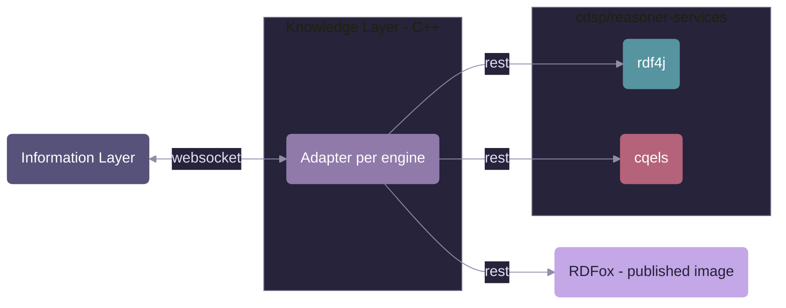

# Reasoner Services

Reasoning engines that run as their own service next to the Knowledge Layer. The Knowledge Layer (C++) talks to them over REST through one adapter per engine; the services themselves are separate from the C++ code and run with Docker or natively.

## Services

| Folder                   | Engine                                                                                            | Docker Compose profile | Knowledge Layer adapter                                                        |
| ------------------------ | ------------------------------------------------------------------------------------------------- | ---------------------- | ------------------------------------------------------------------------------ |
| [rdf4j](rdf4j/README.md) | RDF4J stream reasoner (Java, Spring Boot), rules in SHACL                                         | `rdf4j`                | [RDF4J adapter](../knowledge-layer/symbolic-reasoner/adapters/rdf4j/README.md) |
| [cqels](cqels/README.md) | CQELS stream reasoner (Java, Spring Boot), continuous queries in CQELS-QL over event-time windows | `cqels`                | not available yet                                                              |

RDFox is not in this folder: it runs from its published image (`oxfordsemantic/rdfox`) and needs a licence. See the [Docker README](../../docker/README.md#rdfox-restful-api).

Each service README describes its build, its endpoints and its limitations.

## Running

- **With Docker Compose:** both compose files ([main setup](../../docker/docker-compose-cdsp.yml) and the [hello-world example](../../examples/knowledgelayer-hello-world/docker-compose.yml)) build the services from this folder. The profile decides which reasoner runs, see the [Docker README](../../docker/README.md).
- **Natively:** build and start the service as described in its README, then point the Knowledge Layer to it with `HOST_REASONER_SERVER` and `PORT_REASONER_SERVER`.

## Common conventions

All services follow the same REST pattern, so the adapters share the request code of the Knowledge Layer:

- Paths below `/datastores/{name}/...`; the datastore name comes from `REASONER_DATASTORE_NAME`.
- Port `12110` by default.
- The Basic `Authorization` header that the Knowledge Layer always sends is accepted, and may be ignored.

## Adding a service

Put the service in its own folder here with a `Dockerfile` and a `README.md`, add it to the compose files under its own profile, and write the adapter as described in the [reasoner integration guide](../knowledge-layer/symbolic-reasoner/adapters/README.md).
