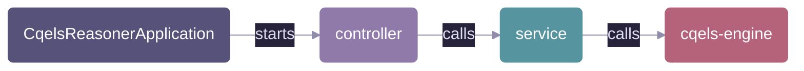

# Source code

The Java source of the CQELS reasoner service, a Spring Boot application. How to build, run and configure the service is in the [service README](../../../../../../../README.md).

## Contents

| Path                               | What it holds                                                                                                   |
| ---------------------------------- | --------------------------------------------------------------------------------------------------------------- |
| `CqelsReasonerApplication.java`    | Entry point. Starts Spring Boot and enables scheduling, which the reorder buffer uses to release held elements. |
| [controller](controller/README.md) | The REST endpoints: parse requests, call the service package, format responses.                                 |
| [service](service/README.md)       | Sessions, the CQELS engines, and the reorder and result buffers.                                                |

The settings and their environment variables (`SERVER_PORT`, `CQELS_RESULTS_BUFFER_SIZE`, `CQELS_REORDER_TOLERANCE`) are in `src/main/resources/application.properties`.

## Tests

The tests in `src/test/java/org/covesa/cdsp/cqels` follow the same structure. Their names end in `UnitTest` (one class, no Spring) or `IntegrationTest` (the whole application through its REST endpoints). Run them with `mvn test`.
