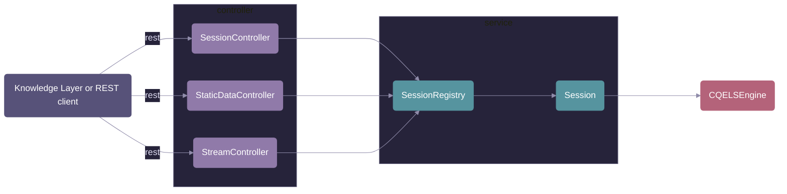

# Controllers

The REST endpoints of the CQELS reasoner service. Each controller turns HTTP requests into calls on the `service` package and turns the answers into HTTP responses. The full API with request and response formats is in the [service README](../../../../../../../../README.md#api).

## Classes

| Class                  | Endpoints                                                                                                                    | What it does                                                                                                                                                |
| ---------------------- | ---------------------------------------------------------------------------------------------------------------------------- | ----------------------------------------------------------------------------------------------------------------------------------------------------------- |
| `SessionController`    | `GET /health`, `GET /datastores`, `POST /datastores/{name}`, `DELETE /datastores/{name}`                                     | Health check; lists, creates and deletes datastores. Each datastore is a `Session` with its own engine.                                                     |
| `StaticDataController` | `POST /datastores/{name}/content`, `POST /datastores/{name}/sparql`                                                          | Loads Turtle into the engine's store and runs one-shot SPARQL SELECT queries on it, as SPARQL JSON or TSV depending on `Accept`.                            |
| `StreamController`     | `POST /datastores/{name}/queries`, `POST /datastores/{name}/streams/{stream}`, `GET /datastores/{name}/queries/{id}/results` | Registers continuous CQELS-QL queries, pushes stream elements with their `eventTime`, and returns the results collected since the last call as SPARQL JSON. |

## Conventions

- **Lookup:** every endpoint below `/datastores/{name}` gets the session from `SessionRegistry` and returns `404` if it does not exist.
- **Errors:** invalid input (Turtle, SPARQL, CQELS-QL, `eventTime`) returns `400` with the reason in the body.
- **No logic here:** ordering of stream elements, result buffering and the engine lifecycle live in the `service` package. The controllers only parse, delegate and format.

## Typical call order

1. `POST /datastores/{name}` creates the session.
2. `POST .../content` loads static data, if the queries need it.
3. `POST .../queries` registers the continuous queries, before the first stream element.
4. `POST .../streams/{stream}?eventTime=...` pushes one element per signal.
5. `GET .../queries/{id}/results` fetches the new results, for example after each push.
6. `DELETE /datastores/{name}` stops the engine.
