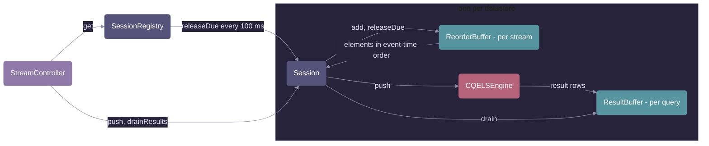

# Service

The sessions of the CQELS reasoner service and the path of a stream element from the REST request to the query results. The [controllers](../controller/README.md) call this package; it is the only package that talks to the CQELS engine.

## Classes

| Class             | What it does                                                                                                                                                                                                                                                                       |
| ----------------- | ---------------------------------------------------------------------------------------------------------------------------------------------------------------------------------------------------------------------------------------------------------------------------------- |
| `SessionRegistry` | Spring service. Keeps one `Session` per datastore name, each with its own in-memory `CQELSEngine`. Reads the settings `cqels.results-buffer-size` and `cqels.reorder-tolerance`. Every 100 ms it releases held stream elements in all sessions; at shutdown it closes all engines. |
| `Session`         | One engine with its streams, continuous queries and buffers. Registers queries (creating their streams first, because the engine only accepts queries on existing streams), pushes stream elements through the reorder buffer, and hands out the buffered results.                 |
| `ReorderBuffer`   | Holds the elements of one stream and releases them in event-time order: once the stream is the tolerance ahead, or once they have waited the tolerance in real time. An element older than one already released is passed on at once with a warning.                               |
| `ResultBuffer`    | Keeps the result rows of one query until they are fetched. Bounded: when full, the oldest rows are dropped, with one warning until the next fetch.                                                                                                                                 |

## Example: ReorderBuffer

One stream, tolerance 500 ms. Event times are in milliseconds. The first five rows are the data of `ReorderBufferUnitTest`.

Two values of the stream decide what happens:

- **Newest:** the highest event time seen so far. Everything held up to newest - 500 is pushed.
- **Last pushed:** the highest event time already pushed to the engine. An element older than this comes too late to be put in order.

| Arrives (real time) | Element (event time) | Newest | Last pushed | Held after | Pushed to the engine | Why                                                                                |
| ------------------- | -------------------- | ------ | ----------- | ---------- | -------------------- | ---------------------------------------------------------------------------------- |
| 0 ms                | 2000                 | 2000   | none        | 2000       | nothing              | Up to 2000 - 500 = 1500: nothing held is that old                                  |
| 0 ms                | 1700 (late)          | 2000   | none        | 1700, 2000 | nothing              | 1700 is above 1500, so it is held and can still go out in order                    |
| 0 ms                | 2600                 | 2600   | 2000        | 2600       | 1700, 2000           | Up to 2600 - 500 = 2100, oldest first                                              |
| 0 ms                | 3100                 | 3100   | 2600        | 3100       | 2600                 | Up to 3100 - 500 = 2600                                                            |
| 500 ms              | none (scheduler)     | 3100   | 3100        | none       | 3100                 | 3100 has waited 500 ms in real time, no newer element needed                       |
| 600 ms              | 1500 (too late)      | 3100   | 3100        | none       | 1500, with a warning | 1500 is older than the last pushed 3100: passed on at once, the engine may drop it |

The engine sees 1700, 2000, 2600, 3100 in event-time order, although 1700 arrived after 2000.

## Lifecycle of a session

1. `SessionRegistry.create` builds the engine. The engine is started with the first pushed element, so queries are registered before it runs.
2. `Session.registerQuery` parses the CQELS-QL query, creates its streams and a `ResultBuffer`, and registers the query with the buffer as its listener. The query id is the `REGISTER QUERY` name.
3. `Session.push` adds the element to the stream's `ReorderBuffer` and pushes whatever it releases to the engine. `SessionRegistry` calls `Session.releaseDue` every 100 ms for elements that waited long enough.
4. The engine writes result rows to the `ResultBuffer`; `Session.drainResults` takes them out, so each row is returned once.
5. `SessionRegistry.delete` closes the engine. Elements still held in a `ReorderBuffer` are dropped, because their results can no longer be fetched.

## Thread safety

- `Session.push`, `Session.releaseDue` and `Session.close` are `synchronized` on the session, so the scheduler and the REST requests never push to the engine at the same time, and nothing is pushed after the engine is closed.
- `ResultBuffer` is written by the engine's threads and read by the REST requests; `add` and `drain` are `synchronized`.
- The session and buffer maps are `ConcurrentHashMap`s.
